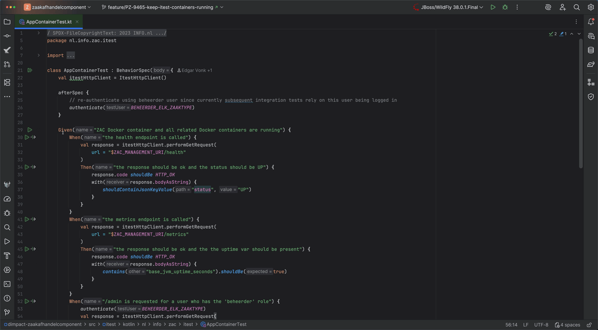
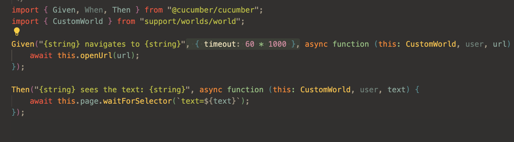
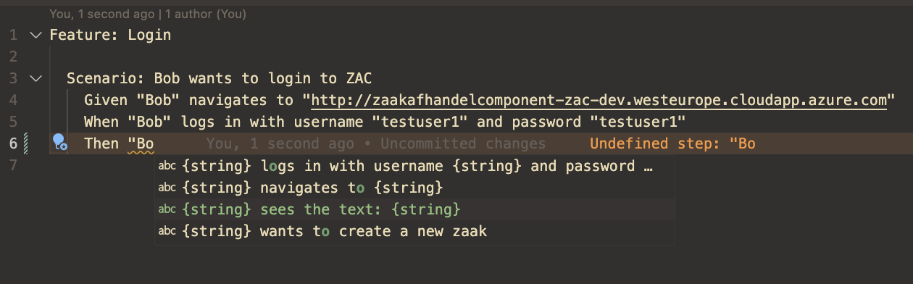
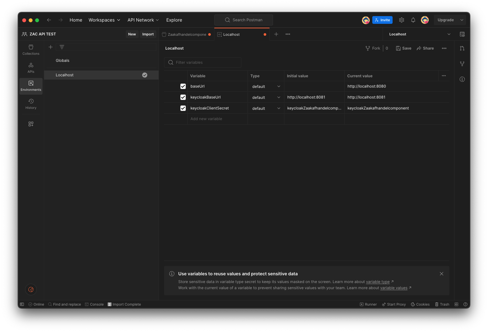
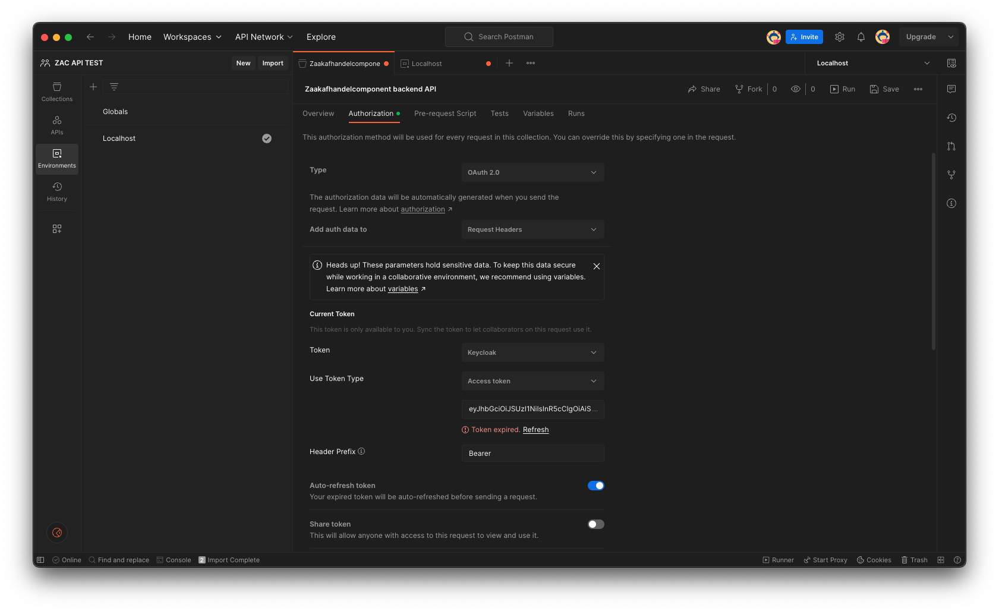
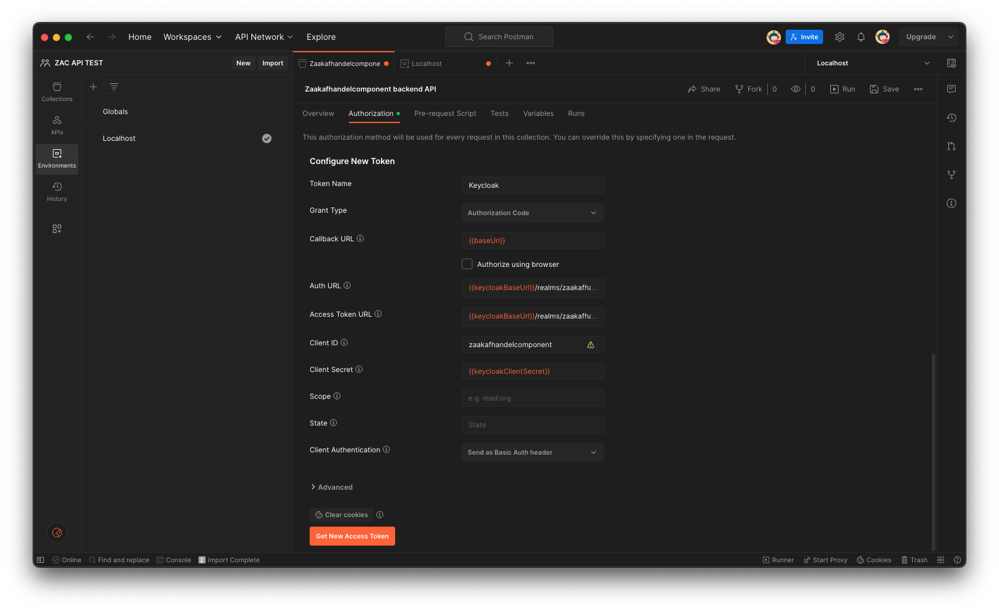

# Testing ZAC

## Unit tests

Both backend and frontend unit tests are run as part of the `test` phase in the normal Gradle build.
You can run them separately using the following command:

```shell
./gradlew test --info
```

In CI the backend and the frontend unit tests run as two jobs at the same time, and the frontend suite is
split over two Jest shards. A small `run-unit-tests` job combines their results into the single
`unit-test-results` check. Run one frontend shard locally with:

```shell
cd src/main/app && npm run test:report -- --shard=1/2
```

## Integration tests

Our integration tests are written as [Kotest](https://kotest.io/) tests. They run against our
[kind set-up](installKind.md): a local Kubernetes cluster with all required services (Keycloak, Open Zaak, etc),
the test doubles of the integration tests (WireMock, GreenMail) and ZAC itself, installed with our ZAC Helm chart
from the ZAC Docker image under test.
This set-up makes it relatively slow to run the integration tests and for this reason they are not run as part of
the standard Gradle `test` phase and normal Gradle build.

You need Docker, [kind](https://kind.sigs.k8s.io/), `kubectl`, [Helm](https://helm.sh/) and Python 3 on your `PATH`
(see [installKind.md](installKind.md)). If you wish to run the integration tests you can use the following command:

```shell
./gradlew itest --info
```

This builds the ZAC Docker image, starts the kind cluster `zac-itest` with `scripts/kind/up.sh`, creates the test
setup data in ZAC, runs the integration tests, collects the code coverage of ZAC and deletes the cluster again.
A `zac-itest` cluster that ZAC already ran in holds the data of an earlier run, so the integration tests delete it
before they start a new one. The integration tests never touch the cluster of `./start-kind.sh`.

The cluster publishes its services on the same host ports as `./start-kind.sh`. When those ports are taken, for
example by your own kind or Docker Compose stack, move them with the environment variables of
[installKind.md](installKind.md), which the integration tests follow too. For example:

```shell
KIND_PORT_OFFSET=2000 ./gradlew itest
```

It is also possible to run the integration tests from inside your IDE (we use IntelliJ IDEA).
To do this you will first need to do the following:

1. Start Docker.
2. Build the ZAC Docker image using the following command:
    ```shell
    ./gradlew buildDockerImage
    ```
3. Run the integration tests from your IDE. Make sure that the `PATH` of the run configuration contains kind,
   `kubectl` and Helm.

### Code coverage of the integration tests

ZAC runs with the [JaCoCo](https://www.jacoco.org/jacoco/) agent in the integration tests (see
`scripts/kind/values/zac-itest.yaml`). After the last spec, the integration tests fetch the coverage from the agent
through the `zac-jacoco` port of the cluster and write it to `build/jacoco/itest/jacoco-report/jacoco-it.exec`.
`./gradlew jacocoIntegrationTestReport` turns it into a report, which CI uploads to Codecov with the flag
`integrationtests`.

### Integration test timings

Every integration test run writes a timing report to `build/reports/itest/timings.md`: how long starting the
kind stack, ZAC becoming healthy, the specs and the teardown took, when each pod started and became ready, and the
slowest specs. Use it to find out where the time goes before trying to speed things up.
In CI the report is published in the job summary of every `itest-shard` job.

CI runs the integration tests without `--info` and writes the full log, including the output of
`scripts/kind/up.sh`, to `build/reports/itest/itest.log` (Gradle property `itestLogFile`). When the tests fail, that
file and the logs of the pods are uploaded as the `integration-test-log-shard-<N>` artifact.

### Integration test shards

CI runs the integration tests in shards: `src/itest/itest-shards.txt` assigns every spec to a shard and the
`itest-shard` matrix job of the build workflow starts one kind cluster per shard and runs only the specs
of that shard, using the Gradle property `itestShard`:

```shell
./gradlew itest -PitestShard=2
```

Every spec has to be assigned to exactly one shard. When a shard is selected, the build fails with a message that
lists the specs that are missing from the file or no longer exist. Use the "Slowest specs" table of the timing
report to keep the shards balanced when adding or moving specs. The `build-docker-image-and-run-itests` job
combines the test results of all shards into the single `integration-test-results` check.

Each CI shard starts the kind cluster and every service but ZAC in the background while it builds the ZAC Docker
image. The integration tests then reuse that cluster, because ZAC has not run in it yet, and only install ZAC.

### Concurrent specs and `@Isolate`

Within one run the specs run concurrently (three at a time by default, each spec on its own thread), in random
order, against the same ZAC and kind stack. A spec must therefore only create, change and assert on
its own data. A spec that touches global state has to carry Kotest's `@Isolate` annotation so that it runs on its
own, before the concurrent specs. This applies to specs that:

- assert on mail in a GreenMail mailbox that other specs or ZAC flows also write to (the mail store is purged
  before every isolated spec; a spec that only uses recipient addresses of its own can run concurrently),
- trigger reindexing, or diff or wait on the ZAC container logs,
- run or assert on the signaleringen jobs or other admin jobs, or reset mocks such as the BRP WireMock journal,
- change configuration that other specs rely on (zaaktype configuration, reference tables, mail templates,
  BPMN process definitions, ...), even when the spec restores it afterwards,
- assert on totals, listings or orderings that the data of other specs changes,
- interfere with the infrastructure, for example by terminating database connections.

The Gradle property `itestSpecConcurrency` overrides the number of concurrent specs, for example
`-PitestSpecConcurrency=1` runs the specs one by one when debugging a failure.

### Configuring the start and stop behaviour of the kind cluster

Using `Run Configuration` in IntelliJ you can set the following environment variables to configure the integration tests behaviour:
* `ZAC_ITEST_KEEP_STACK` - do not delete the kind cluster after the tests finish executing
* `ZAC_ITEST_USE_RUNNING_STACK` - do not start the kind cluster, and do not create the test setup data: run against
  the cluster that an earlier run with `ZAC_ITEST_KEEP_STACK` kept
* `ZAC_ITEST_KIND_CLUSTER_NAME` - the name of the kind cluster of the integration tests (default: `zac-itest`)



In such way you can run the integration tests in a more controlled environment and start up the kind cluster only
once. `./start-it-with-local-env.sh` sets these variables with its options `-c` and `-s`.

### Debugging integration tests

Debugging integration tests can be challenging because of the Kubernetes environment used but also in large part because of the ordering dependency between many of these tests.
The following steps can help you debug failing integration tests:

1. Build the ZAC Docker Image. See instructions above.
2. Set `ZAC_ITEST_KEEP_STACK=true`, so that you can inspect the cluster after the run.
3. In IntelliJ run the integration tests in debug mode. On the `src\itest` folder right-click and select `Debug Tests in Zaakafhandelcomponent `
   1. Click on the `Instantiating tests` line in the IntelliJ Console so you can see the output of the tests.
   2. Check for failures. Focus on the first test that fails since one failing test typically cascades into other failing tests down the line since we have lots of ordering dependencies between our integration tests.
   3. If all tests fail this usually indicates that ZAC itself does not even start up. In that case forget about the integration tests and first try to get ZAC starting up locally with `./start-kind.sh -l`. 
   Come back here once this is fixed.
   4. If there are tests failing add a debug breakpoint in IntelliJ just before and just after this test is run.
      1.  When the first breakpoint is reached, follow the ZAC logs (and possibly the logs of other pods depending on the test) so you can clearly see the output of ZAC:
          `kubectl --context kind-zac-itest --namespace zac logs deployment/zac --container zaakafhandelcomponent --follow`.
      2.  Continue running until the second breakpoint is reached. In most cases you can find out from the logs what the issue is.
      3.  When the integration tests are on a breakpoint you can also do manual testing in the ZAC user interface from a browser to troubleshoot.

## End-to-end (e2e) tests

Our end-to-end tests use the [Playwright e2e test framework](https://playwright.dev/).
We use [Cucumber](https://cucumber.io/) to write reusable end-to-end tests in human-readable format using [Gherkin syntax](https://cucumber.io/docs/gherkin/).

### Running the e2e tests

The end-to-end tests are located in the `src/e2e` folder.
You can use the [start-e2e-with-local-env.sh](../../start-e2e-with-local-env.sh) script if you want to run the end-to-end tests against the [local kind stack](#running-e2e-tests-locally),
or [start-e2e-with-test-env.sh](../../start-e2e-with-test-env.sh) if you want to run the end-to-end tests against the INFO TEST environment (accessible for INFO developers only).
Most features need the users, groups and zaaktypes of the TEST environment, which the local stack does not have.
These features have the tag `@live-env-only`, and the local script leaves them out.

To run the tests in headless mode you can use the following command:

```shell
HEADLESS=true ./start-e2e-with-test-env.sh
```

#### Running only a single test feature

To run a single test feature (or similar features with the same tag), you can use the `TAGS` environment variable.
For example, to only run the test scenario(s) with the tag `@bpmn` in headless mode on the TEST environment,
you can use the following command:

```shell
HEADLESS=true TAGS="@bpmn" ./start-e2e-with-test-env.sh
```

### Writing e2e tests

We have predefined steps that you can use to write tests. You can find them in the [src/main/e2e/step-definitions](../../src/e2e/step-definitions) folder. each file in this folder represents a specific domain, like "zaak" is meant for non reusables steps that are specific to the "zaak" domain. steps in common are meant to be reusable across domains.


In a .feature file you should be able to write out tests based on the predefined steps with auto complete.


### Using the right selectors in the e2e tests

For selecting elements in our end-to-end (e2e) tests, we follow best practices from [Testing Library](https://testing-library.com/docs/queries/about/#priority). This ensures that our tests reflect real user interactions and are more resilient to UI changes.

The categories we use for selecting an element:

1. Queries accessible for everyone
   
    We prioritize queries like getByRole, getByText, getByLabel, which mimic how users interact with the UI (e.g., buttons, text inputs). These ensure our tests are aligned with user experience.

3. Semantic Queries
   
    These selectors are based on accessible properties such as aria-label or aria-role, helping us target elements that are meaningful for screen readers and assistive technologies.

5. ID Selectors

    We avoid using id selectors or data-testid in most cases as they can be less stable and a user cannot see the id of a element which goes against testing regulations. IDs are prone to being altered during development making tests fragile and hard to maintain.

### Generating e2e tests with Playwright Codegen

You can use the Playwright Codegen tool to generate e2e tests. This is a great way to get started with e2e tests. You 
can find more information about this tool [here](https://playwright.dev/docs/codegen).

You can run the following command to generate a test with taking the INFO.nl test environment as a base:

```shell
npx playwright codegen https://zaakafhandelcomponent-zac-dev.dimpact.lifely.nl
```

This will open a Chrome window, will record all your clicks, and will generate code that you can copy paste into your cucumber test.

#### Writing Cucumber tests in IntelliJ

You need to make sure to install the [cucumber.js](https://plugins.jetbrains.com/plugin/7418-cucumber-js) plugin.

Then you will have all the autocomplete features available to you

#### Writing Cucumber tests in VSCode

You need to make sure to install the official [cucumber](https://marketplace.visualstudio.com/items?itemName=CucumberOpen.cucumber-official) plugin.

Then you will have all the autocomplete features available to you

### Running e2e tests locally

The local e2e tests run against ZAC in the [kind stack](installKind.md). The browser of the tests runs on your
machine and uses the same `localhost` URLs of ZAC and Keycloak as your own browser, so no `/etc/hosts` entry is needed.

1. Start the kind stack with ZAC in the cluster, for example with a ZAC Docker image that you build first:

   ```sh
   ./start-kind.sh -b
   ```

   `-l` uses an image that you built before, and `-z` the image of the registry (amd64 only).

2. Run the e2e tests:

   ```sh
   ./start-e2e-with-local-env.sh
   ```

The script reads the host port of ZAC from the stack, so it also works with `KIND_PORT_OFFSET` or `KIND_PORT_ZAC`.
For a cluster with another name, set `KIND_CLUSTER_NAME` for both scripts:

```sh
KIND_CLUSTER_NAME=zac-e2e KIND_PORT_OFFSET=11000 ./start-kind.sh -b
KIND_CLUSTER_NAME=zac-e2e HEADLESS=true ./start-e2e-with-local-env.sh
```

The tests log in as the [local test users](#local-test-users) `beheerder1` and `behandelaar1`. Set
`E2E_TEST_USER_1_USERNAME`, `E2E_TEST_USER_1_PASSWORD`, `E2E_TEST_USER_2_USERNAME` and `E2E_TEST_USER_2_PASSWORD` to
use other users, and `ZAC_URL` for a ZAC that runs elsewhere, for example in your IDE.

The [Playwright Tests on kind](../../.github/workflows/run-e2e-on-kind.yml) workflow runs the same tests in the
pipeline, for pull requests that change the e2e tests or the kind stack.

## GitHub Action Tests

As GitHub pipelines are code as well, we should make an attempt to test their
behaviour before any changes are pushed to the GitHub repository, before it
breaks the build itself.

For simple testing we use the ACT framework. Please refer to [scripts/github/README.md](../../scripts/github/README.md).
This contains the details on how to run ACT tests.

## Open Policy Agent (OPA) Rego Tests

The policies are unit tested with OPA's own test runner. The tests run in the backend unit test job of the
CI pipeline, not in the integration test stack, so the integration test shards no longer wait for them.

To run them yourself, use the Docker Compose service that the pipeline uses:
```shell
docker compose --profile opa-tests run --rm --no-deps opa-tests
```

There are several useful flags that can be used to develop and debug [tests with OPA](https://www.openpolicyagent.org/docs/latest/policy-testing/).

## Manual tests

### Local test users

Several local test users are provisioned in Keycloak when you run ZAC locally using our Docker Compose set-up or
our [kind set-up](installKind.md).
You can use these users to log in to ZAC when running it locally. 

For all of these local test users the password is equal to the username.

You can find the set of these local test users in the [ZAC Keycloak realm import file](../../scripts/docker-compose/imports/keycloak/realms/zaakafhandelcomponent-realm.json) 
or in the set of [integration test user constants](../../src/itest/kotlin/nl/info/zac/itest/config/TestUsers.kt). 

### Using Postman

Using [Postman](https://www.postman.com/) you can test ZAC by sending HTTP requests to the ZAC backend API.
This way you can test a locally running ZAC or you can test ZAC running on e.g. the TEST environment. Be aware that by doing so, depending on the requests you send, you can be changing data and state in ZAC.

#### Set up Postman for ZAC

As a INFO.nl developer you can use our shared Postman ZAC collection in our [ZAC API TEST Postman team workspace](https://zaakafhandelcomponent.postman.co/workspace/aec6c5c4-affd-490b-9c81-e8b1cf339d22).
Alternatively you can set up a Postman collection yourself using the instructions below.

To use our shared Postman collection you need to be a member of our Zaakafhandelcomponent Postman team (max 3 members for the free Postman version).

##### Import ZAC OpenAPI spec

1. Make sure your locally cloned ZAC Git repo is up-to-date, and you have recently run a build (see [INSTALL.md](INSTALL.md) for instructions).
2. In Postman select ‘File - Import’ and select the generated OpenAPI spec file in the `../../build/generated/openapi/META-INF/openapi` folder.
3. Select to create a new Postman Collection.

##### Create environment(s)

Create a Postman environment (e.g. “Localhost”) with the following variables:

| Variable             |        Description         |        Value for ZAC on localhost         |
|----------------------|:--------------------------:|:-----------------------------------------:|
| baseUrl              |        ZAC base URL        |           http://localhost:8080           |
| keycloakBaseUrl      |     Keycloak base URL      |           http://localhost:8081           |
| keycloakClientSecret | Keycloak ZAC client secret | keycloakZaakafhandelcomponentClientSecret |

Also see:



When testing ZAC running on a different environment please set the values accordingly.

##### Set up OAuth2 authorization using Keycloak

Next in the collection you have created set up authorization at the top level of this collection. Use the following settings in the Authorization tab:

| Variable              |                                     Value                                      |
|-----------------------|:------------------------------------------------------------------------------:|
| Type                  |                                     Oauth2                                     |
| Add auth data to      |                                Request headers                                 |
| Header prefix         |                                     Bearer                                     |
| Auto-refresh token    |                                    enabled                                     |
| Use token type        |                                  Access token                                  |
| Token name            |                                    Keycloak                                    |
| Grant type            |                               Authorization code                               |
| Callback URL          |                                  {{baseUrl}}                                   |
| Auth URL              | {{keycloakBaseUrl}}/realms/zaakafhandelcomponent/protocol/openid-connect/auth  |
| Access Token URL      | {{keycloakBaseUrl}}/realms/zaakafhandelcomponent/protocol/openid-connect/token |
| Client ID             |                             zaakafhandelcomponent                              |
| Client secret         |                            {{keycloakClientSecret}}                            |
| Scope                 |                                     openid                                     |
| State                 |                                    (empty)                                     |
| Client authentication |                           Send as basic auth header                            |

Also see:




##### Generate access token

1. In the authorization tab click ‘Get New Access Token’
2. Log in to ZAC using the appropriate (test) user account.
3. Now you should be able to any send requests to ZAC defined in the Postman collection.
